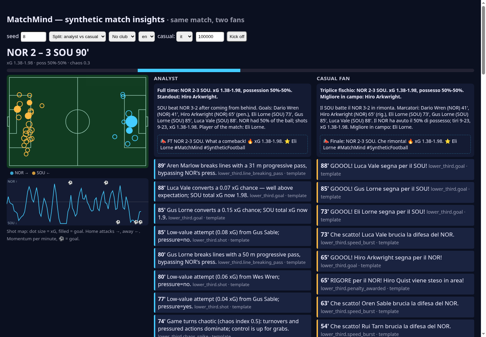
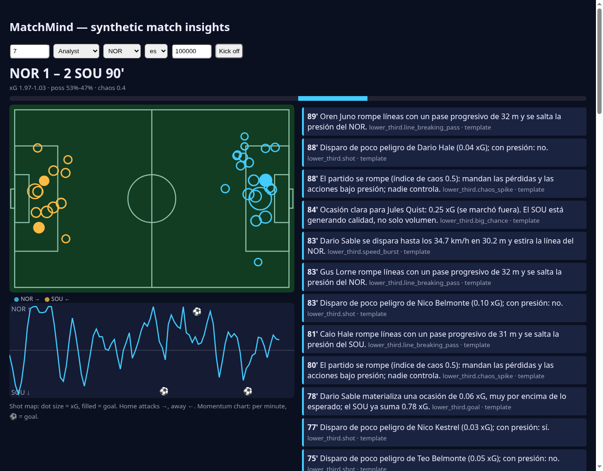
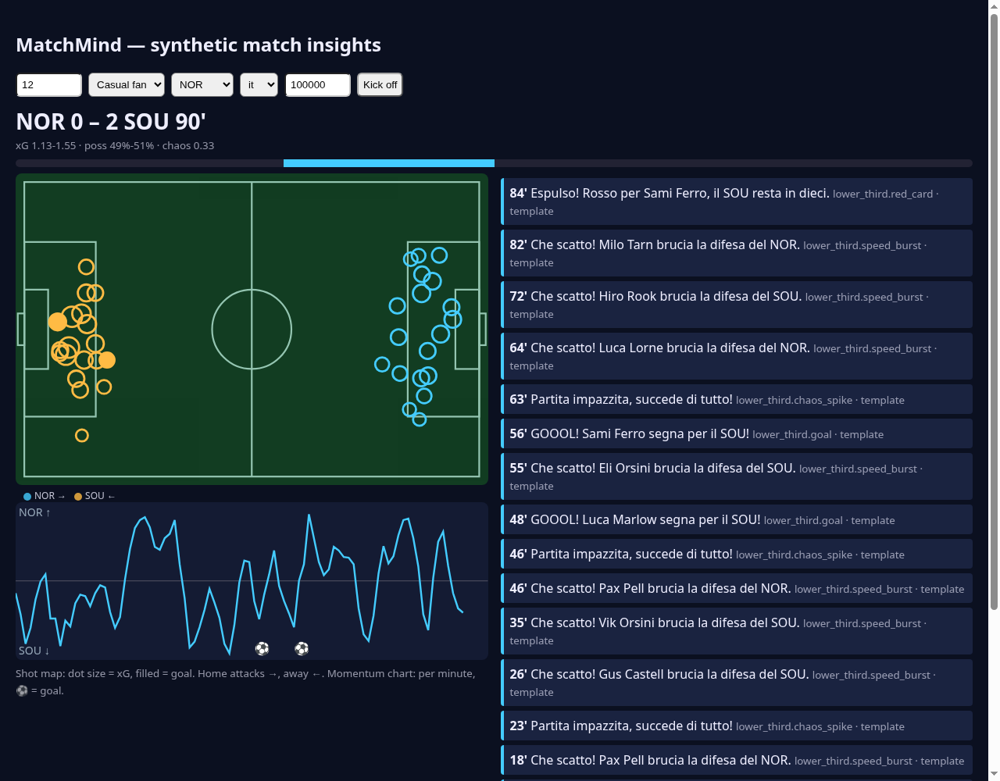
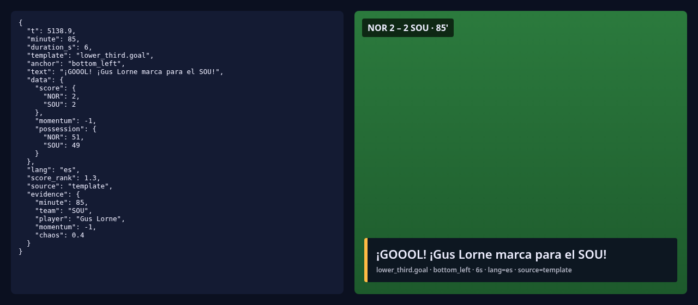
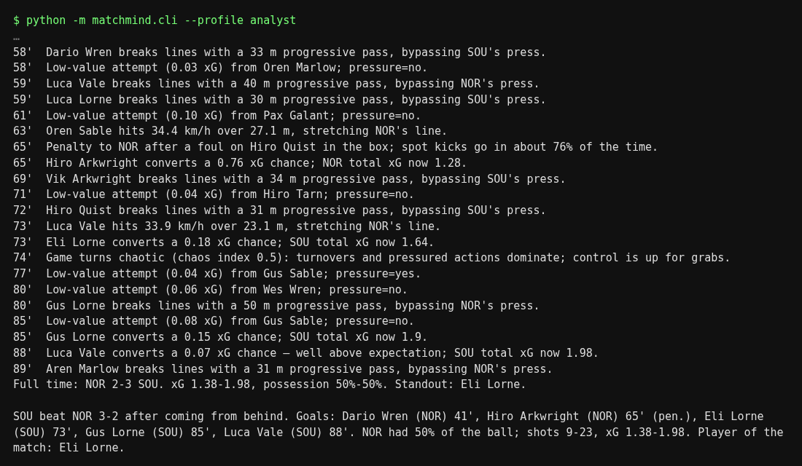

# MatchMind ⚽🤖 — Synthetic Match Insights Engine

Entry for **Microsoft × Premier League "Inside the Game: Developer Hackathon"** (2026). Built in public by [@nico](https://goalworld.fun).

MatchMind turns a **synthetic, football-realistic event stream** into **explainable, personalised, broadcast-ready match intelligence**:

```
Ingest → Interpret → Explain → Render → Personalize
events   MatchState   Explainer  Renderer   Personalizer (+ Narrator)
```

- **Synthetic data engine** (`matchmind/generator.py`): seeded, reproducible matches with passes, shots (xG model), tackles, possession changes, pressure, carries (speed/distance) and match metadata. Fictional players and clubs only — no real data or footage.
- **Multi-agent pipeline** (`matchmind/agents.py`, `pipeline.py`): Analyst (key-moment detection with thresholds/cooldowns), Explainer (*why* it matters, with auditable evidence), Narrator (Azure AI Foundry model, deterministic fallback), Personalizer (persona / favourite club / focus player / language), Renderer (timed overlay cues JSON). The Orchestrator recovers from agent failures.
- **Explainability metrics**: momentum (−1..1), control-vs-chaos index, xG, progressive passes, pass accuracy.
- **Live demo UI** (`web/index.html`) via Server-Sent Events; same match, two genuinely different experiences (analyst vs casual fan).

**▶ Try it now (free static replay):** https://theneuralwars.github.io/matchmind/?autostart=1&view=split&seed=8&lang=en&lang2=it
It shows precomputed replays of the real pipeline (template narration) and is rebuilt by GitHub Actions on every push via `python -m matchmind.static_export`. Submission text: [docs/SUBMISSION.md](docs/SUBMISSION.md).

## Quickstart
Requires only **Python 3.9+**. There are no dependencies and no API keys, and everything runs offline at $0.
```bash
git clone https://github.com/TheNeuralWars/matchmind && cd matchmind
python -m unittest -v                                   # full suite, stdlib only
python -m matchmind.cli --profile analyst --lang es     # narrated demo match (seed 8) + recap + social post
python -m matchmind.server                              # open http://localhost:8000 (pick persona / club / en·es·it)
#   split screen: http://localhost:8000/?autostart=1&view=split&seed=8&lang=en&lang2=it&speed=600
python -m matchmind.mcp_server                          # MCP server over stdio (see below)
python -m matchmind.dataset --out data/ --seeds 0-199 --random-styles   # synthetic dataset (CSV + JSONL)
```
Stream endpoint directly: `curl -N "localhost:8000/stream?seed=8&persona=casual&club=NOR&lang=es&speed=600"`
(SSE events: `meta`, `state`, `shot`, `cue`, `recap`). The UI draws a live SVG shot map, sized by xG with goals filled, and a per-minute momentum chart. It is plain JS with no build step.

### Generator knobs
```python
from matchmind.generator import generate_match
meta, events = generate_match(seed=8,
    home_style={"possession": 0.8, "pressing": 0.7, "directness": 0.3, "formation": "4-3-3"},
    away_style={"possession": 0.3, "directness": 0.9, "formation": "3-5-2"})
```
Styles run 0..1. The formations are `4-3-3`, `4-4-2`, `4-2-3-1` and `3-5-2`. Fatigue builds from 60' and makes the late game sloppier and more open.
Set pieces are included: corners, free kicks and penalties, plus yellow and red cards (a sent-off player leaves the pitch). Trailing teams push forward. Calibrated to ~2.6 goals per match, with ~90% of matches ending 0–4 goals. See **[DATA_CARD.md](DATA_CARD.md)** for exactly what is (and isn't) realistic.

### Languages
English, Spanish and Italian have hand-written native templates (`matchmind/i18n.py`) in an analyst register and a casual-fan register.
If Azure AI Foundry is configured it writes the lines; if it fails, the output falls back to the localised templates.

Optional Azure AI Foundry narration: set `AZURE_OPENAI_ENDPOINT`, `AZURE_OPENAI_API_KEY`, `AZURE_OPENAI_DEPLOYMENT`.

## MCP server (match-state tools)
`matchmind/mcp_server.py` is a dependency-free MCP server that speaks JSON-RPC 2.0, newline-delimited over stdio. Its tools:
`get_score`, `get_momentum`, `get_key_moments` and `explain_moment` (en/es/it, analyst or casual). Each takes a `seed` and, optionally, a `minute`.
```json
{"mcpServers": {"matchmind": {"command": "python", "args": ["-m", "matchmind.mcp_server"], "cwd": "/path/to/matchmind"}}}
```
Smoke test: `printf '{"jsonrpc":"2.0","id":1,"method":"tools/call","params":{"name":"get_score","arguments":{"seed":7,"minute":45}}}\n' | python -m matchmind.mcp_server`

## Microsoft Agent Framework (optional)
`matchmind/agent_framework_adapter.py` wraps the same tools (`matchmind/tools.py`) as Agent Framework function tools.
The import is guarded, so MatchMind runs and tests without it.
```bash
pip install agent-framework azure-identity   # optional
```
```python
import asyncio
from matchmind.agent_framework_adapter import build_agent
agent = build_agent()   # AzureOpenAIChatClient from AZURE_OPENAI_ENDPOINT / _API_KEY / _DEPLOYMENT (or `az login`)
print(asyncio.run(agent.run("Seed 7: who was on top after the hour, and why? Rispondi in italiano.")).text)
```
You can also pass any Agent Framework chat client: `build_agent(chat_client=my_client)`. *Not yet tested live because it needs an Azure login.*

## Screenshots
| | |
|---|---|
|  **Split view**: same match, analyst (EN) vs casual fan (IT) |  **Architecture**: see [docs/ARCHITECTURE.md](docs/ARCHITECTURE.md) |
|  Analyst, Spanish: shot map, momentum, cues, recap |  Casual fan, Italian: red card + goals |
|  Overlay cue JSON → rendered lower-third |  CLI narrated run + post-match article |

Regenerate the UI screenshots with headless Chrome via the deep link, e.g. `/?autostart=1&view=split&seed=8&lang=en&lang2=it&speed=100000`.

## Azure
- **Azure Container Apps** (scale-to-zero, Consumption free grant) — `infra/deploy-containerapp.sh`, `Dockerfile`
- **Microsoft Foundry / Azure OpenAI** — narrator + multilingual output (`matchmind/llm.py`)
- **Microsoft Agent Framework** adapter + **MCP** match-state server (see above)
- Roadmap: Azure Functions event ingestion, Cosmos DB free tier for match state.

## Overlay cue format
```json
{"t": 1234.5, "minute": 20, "duration_s": 6, "template": "lower_third.goal", "anchor": "bottom_left",
 "text": "...", "data": {"score": {...}, "momentum": 0.4, "possession": {...}}, "lang": "en",
 "score_rank": 1.3, "source": "foundry|template", "evidence": {...}}
```

## License
MIT
