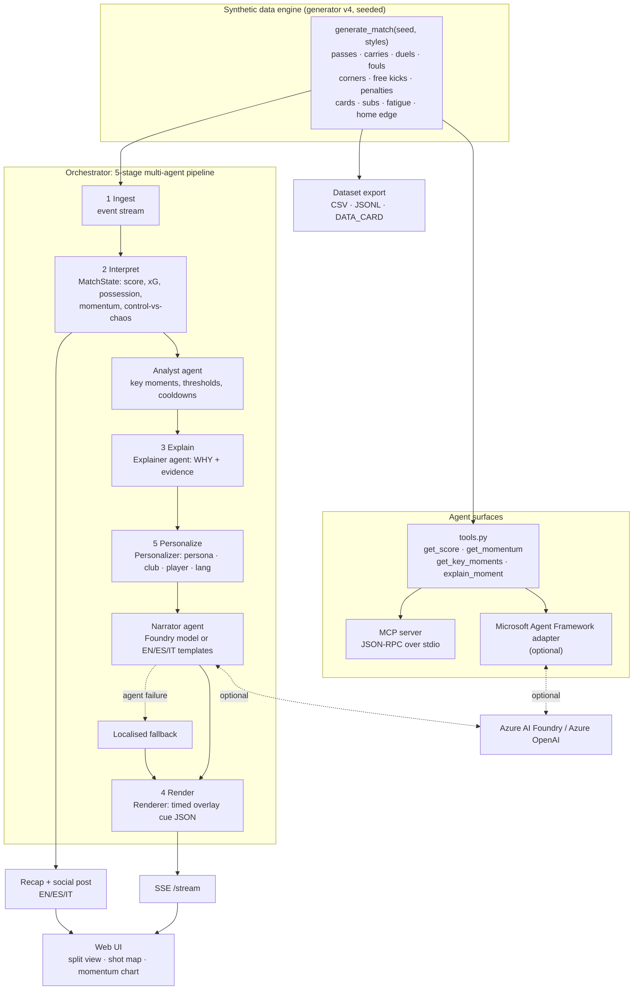

# MatchMind architecture

Rendered with `npx @mermaid-js/mermaid-cli -i docs/architecture.mmd -o docs/architecture.png`.

## Components
| stage / part | module | role |
|---|---|---|
| Synthetic data | `matchmind/generator.py` | Seeded event stream. Team styles, formations, fatigue, set pieces, cards, subs, home advantage. See [DATA_CARD](../DATA_CARD.md). |
| 1 Ingest | `pipeline.Orchestrator.step` | One event at a time, in match order. |
| 2 Interpret | `matchmind/state.py` | Incremental MatchState: score, xG, possession, pass accuracy, progressive passes, momentum (−1..1), control-vs-chaos. |
| Analyst agent | `agents.AnalystAgent` | Detects key moments (goal, big chance, penalty, red card, speed burst, line-breaking pass, momentum swing, chaos spike), with cooldowns so cues don't repeat too often. |
| 3 Explain | `agents.ExplainerAgent` | Says *why* a moment matters and attaches auditable evidence. Keeps language-neutral params. |
| 5 Personalize | `agents.PersonalizerAgent` | Re-ranks and filters moments per fan: persona, favourite club, focus player, language. |
| Narrator agent | `agents.NarratorAgent` + `llm.py` | Writes the line with Azure AI Foundry when configured. Otherwise uses native EN/ES/IT templates (`i18n.py`). |
| Recovery | `i18n.fallback` | If the Narrator fails, the line falls back to the localised template, then to a generic localised line. The match never stops. |
| 4 Render | `agents.RendererAgent` | Timed overlay cue JSON (template, anchor, duration, data, evidence, source). |
| Recap | `matchmind/recap.py` | Post-match article + social post (EN/ES/IT), built only from event facts. |
| Delivery | `server.py`, `web/index.html` | SSE stream and a plain-JS UI: split view, shot map, momentum chart. |
| Agent surfaces | `tools.py`, `mcp_server.py`, `agent_framework_adapter.py` | The same four match-state tools, served over MCP (stdio JSON-RPC) and as optional Microsoft Agent Framework function tools. |
| Dataset | `matchmind/dataset.py` | CSV/JSONL/matches.json export for analysis or model work. |

Design choices: everything runs offline on the standard library at $0. The model is an *enhancement*, never a dependency. Every number shown to a fan can be traced to events.
